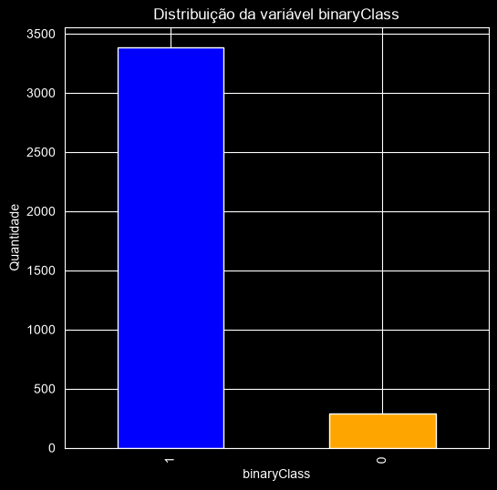
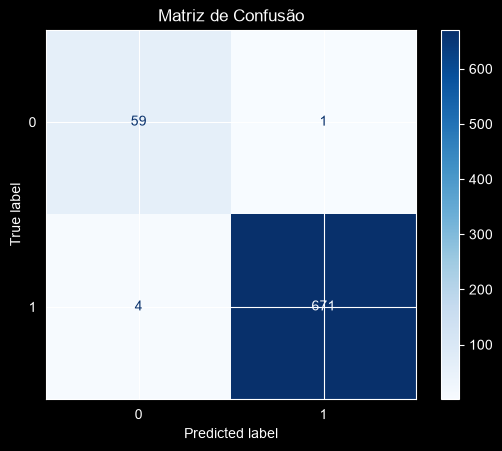

# Detecção de Disfunção Tireoidiana com Machine Learning

Projeto de classificação desenvolvido no curso **Profissão: Cientista de Dados (EBAC)**, Módulo 43, a partir de um briefing de cliente da área de saúde. O objetivo é identificar, a partir de exames hormonais e histórico clínico, pacientes com disfunção da tireoide, priorizando a **minimização de falsos negativos** (pacientes doentes classificados como saudáveis).

Três modelos foram comparados em três cenários de pré-processamento. O **Random Forest com padronização e SMOTE** foi o escolhido: **recall de 0,98 e precisão de 0,94 na classe positiva, com 1 único falso negativo em 60 casos**.

---

## 1. O problema

O cliente pediu um modelo que:

1. alcance boa precisão;
2. seja robusto;
3. minimize os falsos negativos;
4. venha acompanhado de uma análise exploratória visual.

Em triagem clínica, o erro mais caro é deixar passar um paciente doente. Por isso a métrica que guiou todas as decisões foi o **recall da classe positiva**, com a precisão como critério de desempate.

> **Nota sobre o rótulo.** O briefing descreve o problema como hipertireoidismo. A análise dos exames, porém, mostra que a classe positiva tem **TSH elevado** (mediana 12,0 contra 1,2 na classe negativa) e **T4 total e FTI baixos** (76 e 78 contra 105 e 108), que é o perfil laboratorial do **hipotireoidismo**. A base é a *Thyroid Disease (Hypothyroid)* do repositório UCI. O modelo detecta a disfunção independentemente do nome, mas o repositório adota o termo neutro "disfunção tireoidiana" para refletir o que os dados mostram.

## 2. Os dados

`data/hypothyroid.csv`: 3.772 pacientes, 30 colunas. Fonte: UCI Machine Learning Repository (Garavan Institute, Sydney).

| Grupo | Colunas | Descrição |
|---|---|---|
| Demográficas | `age`, `sex` | Idade e sexo |
| Histórico clínico (t/f) | `on thyroxine`, `query on thyroxine`, `on antithyroid medication`, `sick`, `pregnant`, `thyroid surgery`, `I131 treatment`, `query hypothyroid`, `query hyperthyroid`, `lithium`, `goitre`, `tumor`, `hypopituitary`, `psych` | Uso de medicação, cirurgias, condições associadas |
| Exames | `TSH`, `T3`, `TT4`, `T4U`, `FTI`, `TBG` | Dosagens hormonais, cada uma com uma flag `* measured` |
| Origem | `referral source` | Fonte de encaminhamento |
| **Alvo** | `binaryClass` | `P` / `N`; após codificação: **0 = positivo (291, 7,7 %)**, **1 = negativo (3.481, 92,3 %)** |

Valores faltantes vinham marcados com `?` e foram lidos como `NaN` na importação.

## 3. Pipeline

```
Carga → EDA (boxplots, nulos, correlação) → Limpeza (outliers, imputação, colunas descartadas)
→ Codificação (Label / One-Hot) → Seleção de features por correlação → Split 80/20
→ Cenário 1: modelos puros → Cenário 2: StandardScaler + SMOTE → Cenário 3: + GridSearchCV (cv=5)
```

Notebook completo: [`notebooks/deteccao_disfuncao_tireoidiana.ipynb`](notebooks/deteccao_disfuncao_tireoidiana.ipynb)
Documentação técnica com a justificativa de cada decisão: [`docs/documentacao_tecnica.md`](docs/documentacao_tecnica.md)

## 4. Resultados

Base de teste: 735 pacientes (60 positivos, 675 negativos).

| Cenário | Modelo | Acurácia | Precisão (pos.) | Recall (pos.) | F1 (pos.) | Falsos negativos | Falsos positivos |
|:--|:--|--:|--:|--:|--:|--:|--:|
| 1. Puro | Random Forest | 0,99 | 0,92 | 0,97 | 0,94 | 2 | 5 |
| 1. Puro | SVM | 0,96 | 0,94 | 0,55 | 0,69 | 27 | 2 |
| 1. Puro | XGBoost | 0,99 | 0,91 | 0,98 | 0,94 | 1 | 6 |
| 2. Padronização + SMOTE | **Random Forest** | **0,99** | **0,94** | **0,98** | **0,96** | **1** | **4** |
| 2. Padronização + SMOTE | SVM | 0,97 | 0,76 | 0,97 | 0,85 | 2 | 18 |
| 2. Padronização + SMOTE | XGBoost | 0,99 | 0,91 | 0,98 | 0,94 | 1 | 6 |
| 3. + Grid Search | Random Forest | 0,99 | 0,94 | 0,98 | 0,96 | 1 | 4 |
| 3. + Grid Search | SVM | 0,97 | 0,76 | 0,97 | 0,85 | 2 | 18 |
| 3. + Grid Search | XGBoost | 0,99 | 0,91 | 0,98 | 0,94 | 1 | 6 |

<p align="center">
  
  
</p>

**Principais conclusões**

- **A acurácia não serve como critério**: com 92 % de negativos, prever "negativo" para todos daria 0,92 de acurácia e 60 falsos negativos.
- **Random Forest (cenário 2) atende aos três objetivos**: 1 falso negativo em 60, a maior precisão entre os modelos (4 alarmes falsos em 675) e desempenho estável nos três cenários.
- **Padronização + SMOTE foi decisivo para o SVM** (27 → 2 falsos negativos), ao custo da precisão (0,94 → 0,76). Para os modelos de árvore, o efeito foi marginal.
- **O grid search não alterou nenhum resultado**: os parâmetros padrão já estavam no teto desta base.
- **Próximo passo sugerido**: ajustar o limiar de decisão do Random Forest (0,4 ou 0,3) para eliminar o último falso negativo, apresentando ao cliente a troca entre falsos negativos e positivos como uma tabela de limiares.

## 5. Estrutura do repositório

```
thyroid-disease-classification/
├── README.md
├── requirements.txt
├── data/
│   └── hypothyroid.csv
├── notebooks/
│   └── deteccao_disfuncao_tireoidiana.ipynb
├── docs/
│   └── documentacao_tecnica.md
└── images/                      ← boxplots, correlações, distribuição de classes e matrizes de confusão
```

## 6. Como executar

```bash
git clone https://github.com/JMateus1997/thyroid-disease-classification.git
cd thyroid-disease-classification
pip install -r requirements.txt
jupyter notebook notebooks/deteccao_disfuncao_tireoidiana.ipynb
```

As três buscas de hiperparâmetros (Random Forest: 216 combinações; SVM: 36; XGBoost: 108; todas com 5 folds) são a parte mais demorada da execução.

## 7. Tecnologias

Python · pandas · NumPy · scikit-learn · XGBoost · imbalanced-learn · Matplotlib · Seaborn

## 8. Autor

**João Mateus Almeida**, projeto desenvolvido no curso Profissão: Cientista de Dados, EBAC.
