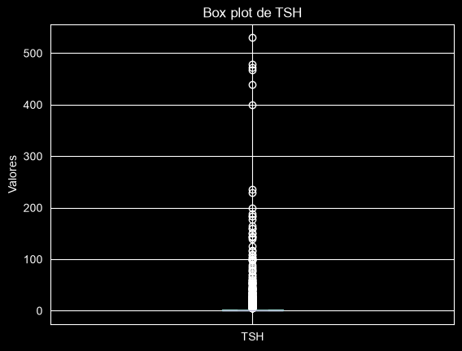
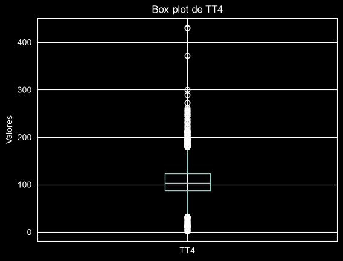
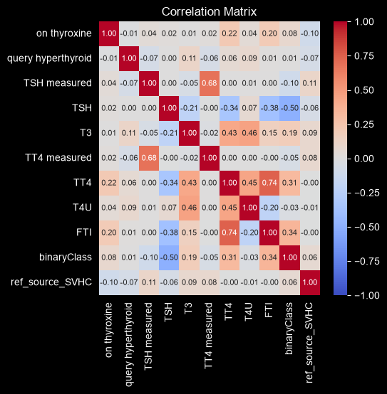
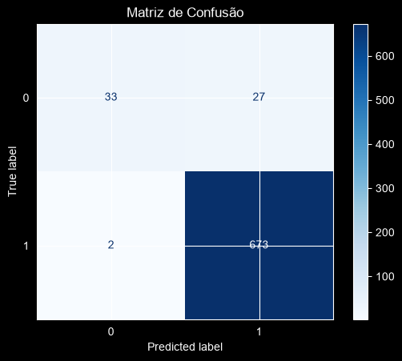

# Documentação Técnica: Detecção de Disfunção Tireoidiana

Curso Profissão: Cientista de Dados (EBAC), Módulo 43
Autor: João Mateus Almeida

---

## Sumário

1. [Contexto e objetivo](#1-contexto-e-objetivo)
2. [Coleta de dados](#2-coleta-de-dados)
3. [Análise exploratória](#3-análise-exploratória)
4. [Limpeza e transformação](#4-limpeza-e-transformação)
5. [Seleção de features](#5-seleção-de-features)
6. [Divisão, balanceamento e padronização](#6-divisão-balanceamento-e-padronização)
7. [Modelagem](#7-modelagem)
8. [Avaliação e comparação](#8-avaliação-e-comparação)
9. [Conclusões](#9-conclusões)
10. [Limitações e próximos passos](#10-limitações-e-próximos-passos)

---

## 1. Contexto e objetivo

O briefing do cliente pedia um modelo de classificação para diagnóstico de disfunção tireoidiana com quatro requisitos: boa precisão, robustez, minimização de falsos negativos e uma análise exploratória visual.

**Objetivo:** prever a variável `binaryClass` (positivo ou negativo para a disfunção) a partir de exames hormonais e histórico clínico do paciente.

**Métrica orientadora:** em triagem clínica, o erro mais caro é o falso negativo (paciente doente liberado como saudável). Por isso o **recall da classe positiva** foi o critério principal de escolha, com a **precisão** como desempate, para evitar excesso de alarmes falsos.

### Sobre o rótulo do problema

O briefing descreve a condição como hipertireoidismo. Os dados contam outra história: a classe positiva tem **TSH mediano de 12,0** (contra 1,2 na negativa) e **TT4 e FTI baixos** (76,5 e 77,5 contra 105 e 108). TSH alto com T4 baixo é o perfil laboratorial do **hipotireoidismo**, e a base é a *Thyroid Disease (Hypothyroid)* do UCI. O pipeline e os resultados são os mesmos em qualquer caso; esta documentação usa o termo "disfunção tireoidiana" para refletir o que os exames mostram.

---

## 2. Coleta de dados

Base pública *Thyroid Disease* do UCI Machine Learning Repository, com 3.772 registros e 30 colunas.

| Coluna | Tipo | Nulos | Observação |
|---|---|--:|---|
| `age` | numérica | 0,03 % | Um registro com 455 anos (erro de digitação) |
| `sex` | categórica | 3,98 % | F / M |
| 15 flags clínicas (`on thyroxine`, `sick`, `pregnant`, `goitre`, `tumor`…) | categóricas t/f | 0 % | |
| `TSH` | numérica | 9,8 % | Hormônio estimulante da tireoide |
| `T3` | numérica | 20,4 % | Tri-iodotironina |
| `TT4` | numérica | 6,1 % | Tiroxina total |
| `T4U` | numérica | 10,3 % | Captação de T4 |
| `FTI` | numérica | 10,2 % | Índice de tiroxina livre |
| `TBG` | numérica | 100 % | Totalmente vazia |
| `* measured` (6 flags) | categóricas t/f | 0 % | Indica se o exame foi feito |
| `referral source` | categórica | 0 % | 5 origens de encaminhamento |
| `binaryClass` | **alvo** | 0 % | P (3.481) / N (291) |

Os valores faltantes vinham marcados com `?`. A base foi recarregada com `na_values=['?']` para que fossem reconhecidos como `NaN`.

---

## 3. Análise exploratória

### 3.1 Estatística descritiva e tipos

`describe()` e `info()` revelaram: idade máxima de 455 (erro evidente), TSH com média 5,1 mas máximo 530 (cauda longa), e `TBG` sem nenhum valor preenchido.

### 3.2 Boxplots das variáveis numéricas

Boxplots de `age`, `TSH`, `T3`, `TT4`, `T4U` e `FTI`. Para cada variável, a quantidade de outliers foi medida com dois critérios: o estatístico (acima de Q3 + desvio padrão) e um limite clínico definido manualmente.

| Variável | Outliers (Q3 + std) | Limite manual | Registros acima do limite | Decisão |
|---|--:|--:|--:|---|
| `age` | 1 | 455 anos | 1 | Remover o registro |
| `TSH` | 95 (2,5 %) | 400 | 5 (0,13 %) | Remover acima de 400 |
| `T3` | 169 sup. / 132 inf. | 7 | 6 (0,16 %) | Remover acima de 7 |
| `TT4` | 262 sup. / 112 inf. | 200 | 69 (1,8 %) | Remover acima de 200 |
| `T4U` | 225 sup. / 89 inf. | | | Manter todos |
| `FTI` | 225 sup. / 105 inf. | 200 | 64 (1,7 %) | Remover acima de 200 |

**Justificativa:** o critério estatístico marcaria de 3 a 7 % dos registros como outliers em cada variável, o que, somado, removeria uma fatia relevante da base e, pior, removeria justamente os pacientes com valores hormonais anormais, que são os casos positivos. Por isso optou-se por cortar apenas os valores extremos (limites manuais), que representam menos de 2 % de cada variável e são fisiologicamente implausíveis ou muito raros, mantendo o restante da cauda.

| Boxplot de TSH | Boxplot de TT4 |
|---|---|
|  |  |

### 3.3 Matriz de correlação

Três matrizes foram geradas ao longo do processo: com as variáveis numéricas originais, com todas as variáveis já codificadas (33 colunas) e com as 10 features selecionadas.

Correlação com o alvo (`binaryClass`): `TSH` **−0,43**, `FTI` 0,33, `T4U` 0,32, `TT4` 0,29, `T3` 0,19, `TSH measured` −0,10, `query hypothyroid` −0,09, `on thyroxine` 0,08, `ref_source_SVHC` 0,06, `TT4 measured` 0,05. Os exames hormonais dominam, como esperado; TSH é a variável mais informativa e com sinal oposto ao dos hormônios T4, coerente com o eixo de regulação da tireoide.

---

## 4. Limpeza e transformação

| Etapa | O que foi feito | Justificativa |
|---|---|---|
| Colunas removidas | `TBG` e `TBG measured` | 100 % nula; a flag tem um único valor, sem informação |
| Alvo codificado | `binaryClass` com `LabelEncoder` (N → 0, P → 1) | Modelos exigem alvo numérico |
| Flags clínicas | `LabelEncoder` nas 15 colunas t/f e em `sex` | Binárias; um inteiro basta |
| `referral source` | One-Hot Encoding (`ref_source_*`), convertido para inteiro | 5 categorias sem ordem natural |
| Outliers | Remoção conforme a tabela da seção 3.2 | Valores extremos e raros |
| Valores faltantes em `TSH`, `T3`, `TT4`, `T4U`, `FTI` | Imputação pela **média**, feita **após** a remoção dos outliers | Essas variáveis têm as maiores correlações com o alvo; descartar linhas (até 20 % em T3) sacrificaria casos positivos. A ordem evita que a média seja contaminada pelos extremos |

Após o tratamento, a base ficou com 3.675 registros.

---

## 5. Seleção de features

Critério: manter apenas as variáveis com correlação absoluta com o alvo **maior que 0,04**. Foram descartadas 21 colunas (`age`, `sex`, a maioria das flags clínicas, as flags `measured` sem relação com o alvo e quatro das cinco origens de encaminhamento).

**Features finais (10):** `on thyroxine`, `query hyperthyroid`, `TSH measured`, `TSH`, `T3`, `TT4 measured`, `TT4`, `T4U`, `FTI`, `ref_source_SVHC`.

**Justificativa:** reduzir dimensionalidade com variáveis que não carregam sinal diminui ruído, tempo de treino (especialmente nas buscas de hiperparâmetros) e risco de sobreajuste. A matriz de correlação recalculada com as 10 features confirmou que a estrutura de correlação com o alvo se manteve.

---

## 6. Divisão, balanceamento e padronização

### 6.1 Treino e teste

`train_test_split` com `test_size=0.2` e `random_state=42`: **2.940 registros de treino e 735 de teste** (60 positivos e 675 negativos no teste).

### 6.2 Desbalanceamento

**92,2 % negativos contra 7,8 % positivos.** Esse desequilíbrio explica o desempenho do SVM no cenário 1 (recall de 0,55 na classe positiva): o modelo aprende a fronteira dominada pela classe majoritária.

**Decisão:** `SMOTE(random_state=42)` aplicado **apenas no treino**, gerando 2.712 registros por classe. O teste permanece com a distribuição real, para que as métricas reflitam o que o modelo encontraria em produção.

### 6.3 Padronização

`StandardScaler` ajustado no treino balanceado (`fit_transform`) e aplicado ao teste (`transform`). Necessário para o SVM, que calcula distâncias; neutro para Random Forest e XGBoost, mas mantido para um pipeline único.

---

## 7. Modelagem

Três modelos, escolhidos pela robustez, foram treinados em três cenários cumulativos:

| Cenário | Padronização | SMOTE | Grid Search |
|---|:-:|:-:|:-:|
| 1. Puro | | | |
| 2. Pré-processado | ✓ | ✓ | |
| 3. Otimizado | ✓ | ✓ | ✓ (cv = 5) |

### 7.1 Random Forest

`RandomForestClassifier(random_state=42)`. Grid: `n_estimators` [100, 200, 500], `criterion` [gini, entropy], `max_features` [auto, sqrt, log2], `max_depth` [None, 10, 20, 40], `min_samples_split` [2, 5, 10]. 216 combinações × 5 folds.

Melhores parâmetros: `criterion='entropy'`, `max_depth=None`, `max_features='sqrt'`, `min_samples_split=2`, `n_estimators=500`.

**Por que:** conjunto de árvores com amostragem de dados e de features; reduz a variância de uma árvore única, não exige padronização e é pouco sensível a outliers, característica valiosa numa base de exames com caudas longas.

### 7.2 SVM

`SVC(kernel='linear', C=1.0, random_state=42)` nos cenários 1 e 2. Grid: `kernel` [linear, poly, rbf, sigmoid], `degree` [2, 3, 4], `C` [0,01, 0,1, 1]. 36 combinações × 5 folds.

Melhores parâmetros: `kernel='linear'`, `C=1` (o `degree` não se aplica ao kernel linear).

**Por que:** maximiza a margem entre as classes e é eficaz em bases pequenas e com poucas features. É também o modelo mais sensível à escala e ao desbalanceamento, o que o torna o melhor termômetro do efeito do pré-processamento.

### 7.3 XGBoost

`XGBClassifier(random_state=42)`. Grid: `n_estimators` [100, 200, 500], `max_depth` [None, 10, 20, 40], `subsample` [0,6, 0,8, 1,0], `learning_rate` [0,01, 0,05, 0,1]. 108 combinações × 5 folds.

Melhores parâmetros: `learning_rate=0.1`, `max_depth=None`, `n_estimators=500`, `subsample=1.0`.

**Por que:** gradient boosting, em que cada árvore corrige os erros das anteriores; é o algoritmo de referência em dados tabulares e tem bom desempenho mesmo com classes desbalanceadas.

---

## 8. Avaliação e comparação

Métricas calculadas na base de teste (735 pacientes): acurácia, precisão, recall e F1 por classe (`classification_report`) e matriz de confusão (`ConfusionMatrixDisplay`).

| Cenário | Modelo | Acurácia | Precisão (pos.) | Recall (pos.) | F1 (pos.) | Falsos negativos | Falsos positivos |
|:--|:--|--:|--:|--:|--:|--:|--:|
| 1. Puro | Random Forest | 0,99 | 0,92 | 0,97 | 0,94 | 2 | 5 |
| 1. Puro | SVM | 0,96 | 0,94 | 0,55 | 0,69 | 27 | 2 |
| 1. Puro | XGBoost | 0,99 | 0,91 | 0,98 | 0,94 | 1 | 6 |
| 2. Padronização + SMOTE | **Random Forest** | **0,99** | **0,94** | **0,98** | **0,96** | **1** | **4** |
| 2. Padronização + SMOTE | SVM | 0,97 | 0,76 | 0,97 | 0,85 | 2 | 18 |
| 2. Padronização + SMOTE | XGBoost | 0,99 | 0,91 | 0,98 | 0,94 | 1 | 6 |
| 3. + Grid Search | Random Forest | 0,99 | 0,94 | 0,98 | 0,96 | 1 | 4 |
| 3. + Grid Search | SVM | 0,97 | 0,76 | 0,97 | 0,85 | 2 | 18 |
| 3. + Grid Search | XGBoost | 0,99 | 0,91 | 0,98 | 0,94 | 1 | 6 |

*Falso negativo: paciente positivo classificado como negativo. Falso positivo: paciente negativo classificado como positivo.*

| Random Forest, cenário 2 | SVM, cenário 1 |
|---|---|
|  |  |

---

## 9. Conclusões

**Modelo recomendado: Random Forest com padronização e balanceamento (cenário 2).** É o que melhor atende, simultaneamente, aos três critérios do cliente:

1. **Minimizar falsos negativos:** deixou passar apenas 1 caso positivo em 60 (recall de 0,98), empatado com o XGBoost e à frente do SVM.
2. **Boa precisão:** 0,94, a maior entre os três modelos. Dos 675 pacientes negativos, apenas 4 receberam um alarme falso, contra 6 do XGBoost e 18 do SVM.
3. **Robustez:** o desempenho praticamente não mudou entre os cenários (recall de 0,97 a 0,98 em todos), mostrando que o modelo é pouco sensível a pré-processamento e hiperparâmetros.

**Por que a acurácia não foi o critério de escolha.** Com 92 % da base composta por negativos, um modelo que classificasse todos os pacientes como negativos teria 0,92 de acurácia e 60 falsos negativos. Em triagem clínica, o que importa é não deixar passar o doente.

**O que o pré-processamento mudou.** Para o SVM, padronização e SMOTE foram decisivos: os falsos negativos caíram de 27 para 2. O custo foi a precisão (0,94 → 0,76), ou seja, o modelo passou a acertar os doentes à custa de 18 alarmes falsos. Para Random Forest e XGBoost, modelos de árvore, o efeito foi marginal.

**O que o ajuste de hiperparâmetros mudou.** Nada, em nenhum modelo. Os parâmetros padrão já estavam no teto de desempenho desta base; o limite está nos dados, não no ajuste.

**Random Forest × XGBoost.** Empatam nos falsos negativos (1 caso). O desempate é a precisão: com o mesmo recall, o Random Forest gera menos exames desnecessários.

---

## 10. Limitações e próximos passos

- **Limiar de decisão.** O modelo classifica como positivo quando a probabilidade passa de 0,5. Reduzir o limiar (0,4 ou 0,3) tende a eliminar o último falso negativo em troca de alguns falsos positivos. Apresentar ao cliente uma tabela de limiares transforma essa troca numa decisão de negócio explícita.

- **Métrica da busca de hiperparâmetros.** O `GridSearchCV` usou `scoring='precision'`, que no scikit-learn mede a precisão da classe 1 (aqui, a negativa). Alinhar a busca ao objetivo do cliente, com `make_scorer(recall_score, pos_label=0)` ou F2-score, pode encontrar configurações mais sensíveis à classe positiva.

- **`max_features='auto'`** não existe mais nas versões recentes do scikit-learn; um terço das combinações do grid do Random Forest falhou por isso (com aviso, sem interromper a busca). Remover a opção do grid limpa a execução sem alterar o resultado, já que a melhor combinação usou `'sqrt'`.

- **Imputação pela média** é a abordagem mais simples; imputar pela mediana (mais robusta a caudas longas, como a de TSH) ou por modelo (KNN) pode melhorar a qualidade das features hormonais.

- **Seleção de features por correlação linear** descarta relações não lineares. Vale testar os modelos de árvore com todas as 31 features e comparar a importância das variáveis (`feature_importances_`).

- **Validação do modelo final** com validação cruzada estratificada na base completa, reportando média e desvio padrão do recall, confirmaria a robustez com mais segurança do que uma única divisão de teste.
